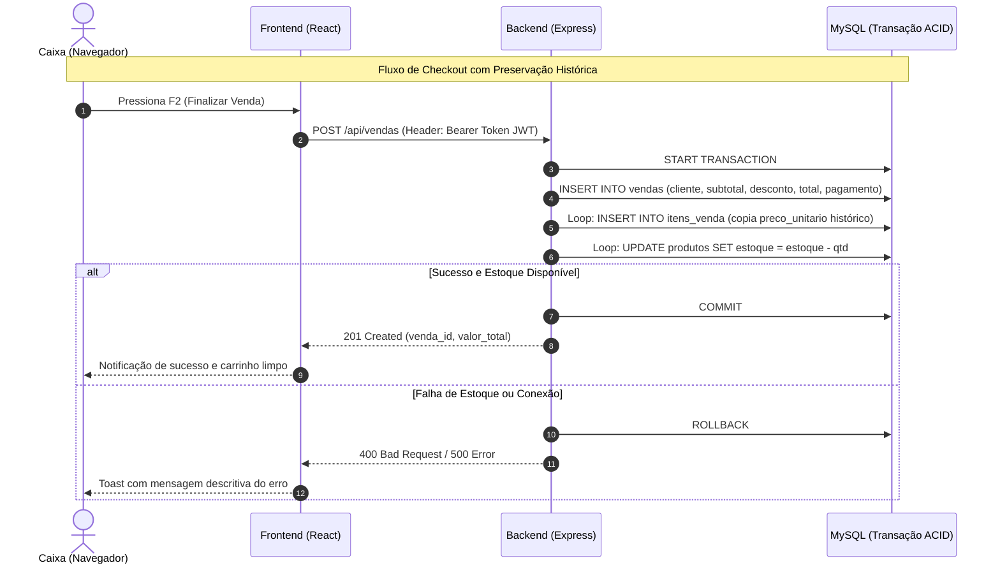

# 🛍️ MS² Vestuário — Sistema de Gestão e Frente de Caixa (PDV)

Sistema comercial completo para gestão de lojas de vestuário e varejo com foco em frente de caixa (PDV de balcão), controle de estoque, abertura/fechamento de turno de caixa com auditoria de saldo, catálogo de produtos, cadastro ágil de clientes, controle de usuários por perfil e histórico analítico de vendas.

---

## 📋 Sumário
1. [Visão Geral](#visão-geral)
2. [Stack Tecnológica](#stack-tecnológica)
3. [Estrutura do Projeto](#estrutura-do-projeto)
4. [Pré-requisitos](#pré-requisitos)
5. [Configuração do Banco de Dados (MySQL)](#configuração-do-banco-de-dados-mysql)
6. [Instalação e Execução do Backend](#instalação-e-execução-do-backend)
7. [Instalação e Execução do Frontend](#instalação-e-execução-do-frontend)
8. [Autenticação e Permissões por Perfil](#autenticação-e-permissões-por-perfil)
9. [Funcionalidades do Sistema](#funcionalidades-do-sistema)
   - [Frente de Caixa (PDV Comercial)](#-frente-de-caixa-pdv-comercial)
   - [Histórico e Auditoria de Vendas](#-histórico-e-auditoria-de-vendas)
   - [Gestão de Clientes](#-gestão-de-clientes)
   - [Catálogo de Produtos](#-catálogo-de-produtos)
   - [Gestão de Usuários](#-gestão-de-usuários)
10. [Roteiro Prático de Demonstração e Testes](#roteiro-prático-de-demonstração-e-testes)
11. [Fundamentos de Engenharia de Software](#fundamentos-de-engenharia-de-software)

---

## Visão Geral

O projeto adota uma arquitetura em camadas orientada a serviços:
- **Frontend SPA**: React 19 com TypeScript, empacotamento rápido via Vite e roteamento seguro com React Router DOM v7.
- **Backend API REST**: Node.js com Express e TypeScript estrito.
- **Banco de Dados Relacional**: MySQL 8+ com integridade referencial, chaves estrangeiras e suporte a transações ACID.
- **Segurança**: Autenticação Stateless via JWT, senhas criptografadas com `bcrypt` e controle de permissões baseado em papéis (RBAC).
- **UX/Design System**: Interface com suporte nativo a **Modo Claro (com alto contraste)** e **Modo Escuro (Slate/Navy)**, responsiva e com foco em agilidade operacional.

---

## Stack Tecnológica

| Camada | Tecnologia | Função no Sistema |
| :--- | :--- | :--- |
| **Frontend** | React 19 + TypeScript | Interface de usuário declarativa, fortemente tipada |
| **Build Tool** | Vite | Servidor de desenvolvimento rápido e bundler otimizado |
| **Roteamento** | React Router DOM v7 | Controle de navegação e rotas protegidas por permissão |
| **Ícones** | Lucide React | Biblioteca de ícones modernos e consistentes |
| **Backend** | Node.js + Express + TypeScript | Servidor da API RESTful com tipagem estrita |
| **Banco de Dados** | MySQL 8+ (Driver `mysql2`) | Persistência relacional de dados transacionais |
| **Autenticação** | JSON Web Token (JWT) | Emissão e validação de tokens de sessão bearer |
| **Criptografia** | bcrypt | Hashing seguro de senhas com salt |

---

## Estrutura do Projeto

```text
PDV_Senai/
├── back-end/
│   ├── src/
│   │   ├── config/          # Conexão e pool do banco de dados (MySQL)
│   │   ├── controllers/     # Controladores das rotas da API
│   │   ├── middlewares/     # Validação de token JWT e checagem de perfil (RBAC)
│   │   ├── models/          # Modelagem de dados e queries SQL
│   │   ├── routes/          # Definição de endpoints HTTP
│   │   └── index.ts         # Inicialização do servidor Express
│   ├── .env                 # Variáveis de ambiente da API
│   ├── package.json
│   ├── seed.ts              # Script para dados iniciais de teste
│   └── tsconfig.json
├── frontend/
│   ├── src/
│   │   ├── components/      # Componentes reutilizáveis (Sidebar, Rotas, Modais)
│   │   ├── pages/           # Telas do sistema (PDV, Vendas, Produtos, Clientes, Usuários, Login)
│   │   ├── services/        # Cliente HTTP (apiFetch, auth, vendas, produtos)
│   │   ├── types/           # Interfaces e tipos compartilhados em TypeScript
│   │   ├── utils/           # Máscaras, validações (CPF/Telefone), moedas e temas
│   │   ├── App.tsx          # Definição das rotas e layouts
│   │   ├── index.css        # Folha de estilo semântica com suporte a Dark/Light Mode
│   │   └── main.tsx         # Ponto de entrada da aplicação React
│   ├── package.json
│   ├── vite.config.ts
│   └── tsconfig.json
├── README.md
└── package.json
```

---

## Pré-requisitos

Para executar o projeto localmente, certifique-se de possuir:
- **Node.js**: versão 20 LTS ou superior
- **npm**: versão 10 ou superior
- **MySQL Server**: versão 8.0 ou superior (rodando localmente ou via container Docker)

---

## Configuração do Banco de Dados (MySQL)

Execute o script SQL abaixo no seu cliente MySQL (Workbench, DBeaver ou terminal) para provisionar o banco de dados e as tabelas com integridade relacional:

```sql
CREATE DATABASE IF NOT EXISTS ms2_vestuario;
USE ms2_vestuario;

CREATE TABLE clientes (
    id INT NOT NULL AUTO_INCREMENT,
    nome VARCHAR(100) NOT NULL,
    cpf CHAR(11) NOT NULL,
    telefone VARCHAR(20) NULL,
    email VARCHAR(100) NULL,
    criado_em DATETIME NOT NULL DEFAULT CURRENT_TIMESTAMP,
    PRIMARY KEY (id),
    UNIQUE KEY cpf_unique (cpf)
) ENGINE=InnoDB DEFAULT CHARSET=utf8mb4;

CREATE TABLE usuarios (
    id INT NOT NULL AUTO_INCREMENT,
    nome VARCHAR(100) NOT NULL,
    email VARCHAR(100) NOT NULL,
    senha VARCHAR(255) NOT NULL,
    perfil VARCHAR(20) NOT NULL,
    ativo TINYINT(1) NOT NULL DEFAULT 1,
    criado_em DATETIME NOT NULL DEFAULT CURRENT_TIMESTAMP,
    PRIMARY KEY (id),
    UNIQUE KEY email_unique (email)
) ENGINE=InnoDB DEFAULT CHARSET=utf8mb4;

CREATE TABLE produtos (
    id INT NOT NULL AUTO_INCREMENT,
    codigo_barras VARCHAR(50) NOT NULL,
    descricao VARCHAR(150) NOT NULL,
    preco DECIMAL(10,2) NOT NULL,
    estoque INT NOT NULL,
    ativo TINYINT(1) NOT NULL DEFAULT 1,
    criado_em DATETIME NOT NULL DEFAULT CURRENT_TIMESTAMP,
    PRIMARY KEY (id),
    UNIQUE KEY codigo_barras_unique (codigo_barras)
) ENGINE=InnoDB DEFAULT CHARSET=utf8mb4;

CREATE TABLE vendas (
    id INT NOT NULL AUTO_INCREMENT,
    cliente_id INT NULL,
    usuario_id INT NOT NULL,
    autorizado_por INT NULL,
    valor_subtotal DECIMAL(10,2) NOT NULL,
    percentual_desconto DECIMAL(5,2) NOT NULL DEFAULT 0.00,
    valor_desconto DECIMAL(10,2) NOT NULL DEFAULT 0.00,
    valor_total DECIMAL(10,2) NOT NULL,
    forma_pagamento VARCHAR(20) NOT NULL,
    status VARCHAR(20) NOT NULL DEFAULT 'FINALIZADA',
    motivo_cancelamento TEXT NULL,
    cancelado_por INT NULL,
    cancelado_em DATETIME NULL,
    data_venda DATETIME NOT NULL DEFAULT CURRENT_TIMESTAMP,
    PRIMARY KEY (id),
    KEY cliente_id_idx (cliente_id),
    KEY usuario_id_idx (usuario_id),
    KEY autorizado_por_idx (autorizado_por),
    KEY cancelado_por_idx (cancelado_por),
    CONSTRAINT fk_vendas_cliente
        FOREIGN KEY (cliente_id) REFERENCES clientes(id),
    CONSTRAINT fk_vendas_usuario
        FOREIGN KEY (usuario_id) REFERENCES usuarios(id),
    CONSTRAINT fk_vendas_autorizado_por
        FOREIGN KEY (autorizado_por) REFERENCES usuarios(id),
    CONSTRAINT fk_vendas_cancelado_por
        FOREIGN KEY (cancelado_por) REFERENCES usuarios(id)
) ENGINE=InnoDB DEFAULT CHARSET=utf8mb4;

CREATE TABLE itens_venda (
    id INT NOT NULL AUTO_INCREMENT,
    venda_id INT NOT NULL,
    produto_id INT NOT NULL,
    quantidade INT NOT NULL,
    preco_unitario DECIMAL(10,2) NOT NULL,
    subtotal DECIMAL(10,2) NOT NULL,
    PRIMARY KEY (id),
    UNIQUE KEY unique_venda_produto (venda_id, produto_id),
    KEY produto_id_idx (produto_id),
    CONSTRAINT fk_itens_venda_venda
        FOREIGN KEY (venda_id) REFERENCES vendas(id),
    CONSTRAINT fk_itens_venda_produto
        FOREIGN KEY (produto_id) REFERENCES produtos(id)
) ENGINE=InnoDB DEFAULT CHARSET=utf8mb4;
```

---

## Instalação e Execução do Backend

1. Acesse o diretório `back-end`:
   ```bash
   cd back-end
   npm install
   ```

2. Crie ou edite o arquivo `.env` dentro de `back-end`:
   ```env
   PORT=3000
   DB_HOST=localhost
   DB_USER=root
   DB_PASSWORD=sua_senha_mysql
   DB_PORT=3306
   DB_NAME=ms2_vestuario
   JWT_SECRET=chave_secreta_pdv_2026
   ```

3. (Opcional) Popule o banco com dados iniciais:
   ```bash
   npm run seed
   ```

4. Inicie o servidor da API em modo de desenvolvimento:
   ```bash
   npm run dev
   ```
   > A API estará rodando em `http://localhost:3000`. O endpoint de healthcheck é `http://localhost:3000/api/health`.

---

## Instalação e Execução do Frontend

1. Abra um novo terminal e acesse o diretório `frontend`:
   ```bash
   cd frontend
   npm install
   ```

2. Inicie o servidor de desenvolvimento do Vite:
   ```bash
   npm run dev
   ```

3. Acesse a aplicação no navegador em:
   ```text
   http://localhost:5173
   ```

---

## Autenticação e Permissões por Perfil

O acesso aos recursos segue uma matriz de controle de permissões (RBAC):

| Perfil | PDV (Caixa) | Clientes | Catálogo de Produtos | Histórico de Vendas | Gestão de Usuários | Autorização de Desconto |
| :--- | :---: | :---: | :---: | :---: | :---: | :---: |
| **CAIXA** | ✅ | ✅ | ❌ | ❌ | ❌ | ❌ (até 10%) |
| **SUPERVISOR** | ✅ | ❌ | ✅ | ❌ | ❌ | ❌ (até 10%) |
| **GERENTE** | ✅ | ✅ | ✅ | ✅ | ✅ | ✅ (ilimitado) |

* **Alçada de Desconto**: Operadores com perfil `CAIXA` ou `SUPERVISOR` podem aplicar descontos de até 10%. Descontos superiores a 10% exigem a liberação em tempo real de um `GERENTE` via modal com senha (`ModalAutorizacaoGerente`).

---

## Funcionalidades do Sistema

### 🛒 Frente de Caixa (PDV Comercial)
A tela de PDV foi projetada nos moldes de SaaS comerciais de balcão (como Shopify POS, Olist e Totvs):

* **Controle de Turno de Caixa (Abertura e Fechamento)**:
  - **Caixa Fechado**: Exibição minimalista e centralizada com relógio digital em tempo real (`tabular-nums`), data completa por extenso e status destacado.
  - **Abertura de Caixa**: Solicitação do valor disponível em espécie para **fundo de troco inicial**.
  - **Fechamento e Auditoria de Caixa**:
    - Demonstrativo do turno em tempo real: Fundo inicial + entradas em dinheiro + vendas eletrônicas = **Saldo esperado na gaveta**.
    - **Regra de Tolerância de R$ 2,00**: O operador insere o valor contado na gaveta. Se a diferença (falta ou sobra) estiver dentro de até **R$ 2,00**, o fechamento é aprovado; se exceder R$ 2,00, o sistema bloqueia o encerramento e orienta a recontagem.
* **Leitor de Código de Barras e Busca Preditiva (Dropdown)**:
  - Input ágil com `auto-focus` persistente e campo de quantidade personalizável.
  - **Dropdown de sugestões em tempo real**: Ao digitar qualquer termo (ex: `"cam"`), filtra e prioriza produtos que começam ou contêm a palavra, exibindo SKU, estoque e preço unitário.
  - Suporte à navegação por teclado: setas <kbd>↓</kbd> / <kbd>↑</kbd> para navegar e <kbd>Enter</kbd> para selecionar, além de clique direto com mouse.
  - Bipagem instantânea com leitores ópticos físicos (código + Enter).
* **Cadastro Rápido de Cliente no Balcão**:
  - Botão `+ Novo Cliente` integrado ao carrinho para cadastrar o cliente na hora da compra sem trocar de tela.
  - Máscara automática e validação algorítmica de CPF (`validarCpf`), telefone e e-mail.
  - Vínculo e seleção automática do cliente cadastrado na venda ativa.
* **Calculadora de Troco Automática**:
  - Ao selecionar a forma de pagamento **Dinheiro**, disponibiliza campo para informar o valor recebido e calcula o troco do cliente instantaneamente.
* **Atalhos Globais de Teclado**:
  - <kbd>Enter</kbd>: Bipar / adicionar produto ou selecionar sugestão do dropdown.
  - <kbd>F2</kbd>: Finalizar a venda ativa (se houver produtos no carrinho).
  - <kbd>Esc</kbd>: Fechar modais abertos, limpar termo de busca ou cancelar a venda em andamento.
* **Barra Lateral com Início Recolhido**:
  - A barra lateral de navegação inicia fechada por padrão (`.recolhida`), maximizando a área útil do balcão para os operadores de caixa.

---

### 📊 Histórico e Auditoria de Vendas
A tela de **Vendas** funciona de forma independente do caixa, permitindo que o gerente consulte o histórico da loja a qualquer momento:
* **KPIs Comerciais**: Total de vendas, faturamento acumulado, ticket médio e percentual de desconto médio.
* **Filtros Dinâmicos**: Busca textual instantânea por cliente e filtro por data específica.
* **Detalhamento Mestre-Detalhe**: Visualização expandida de cada pedido com os itens comprados, preços históricos aplicados e operador responsável.
* **Cancelamento de Venda**: Permite ao gerente cancelar vendas registradas informando o motivo formal para fins de auditoria e conformidade fiscal.

---

### 👥 Gestão de Clientes
* Cadastro com validação estrita de CPF (dígitos verificadores oficiais).
* Máscara inteligente para CPF (`000.000.000-00`) e Telefone (`(00) 00000-0000`).
* Prevenção de duplicidade de documentos no banco de dados.

---

### 📦 Catálogo de Produtos
* Cadastro com código de barras/SKU exclusivo, descrição, preço de venda e saldo de estoque.
* Atualização de dados cadastrais e controle de ativação/inativação de produtos.

---

### 🛡️ Gestão de Usuários
* Administração de operadores da loja com atribuição de perfis (`CAIXA`, `SUPERVISOR`, `GERENTE`).
* Bloqueio de inativação acidental da própria conta de gerente logada.

---

## Roteiro Prático de Demonstração e Testes

Para validar a integridade de ponta a ponta:

1. **Acesso com Perfil Caixa**:
   - Faça login com um operador de caixa.
   - Acesse o **PDV**. Note a tela de **Caixa Fechado** com o relógio em tempo real.
   - Clique em **"Abrir Caixa"** e informe um fundo de troco (ex: `R$ 100,00`).
2. **Leitura de Produtos com Dropdown**:
   - Digite `"cam"` no campo de código de barras. Observe o dropdown listando as opções correspondentes com preço e saldo de estoque.
   - Use as setas <kbd>↓</kbd> / <kbd>↑</kbd> e pressione <kbd>Enter</kbd> para adicionar o produto ao carrinho.
   - Teste digitar o código de barras exato (simulando um leitor físico) e aperte <kbd>Enter</kbd>.
3. **Cadastro Rápido de Cliente**:
   - No painel lateral, clique em **"+ Novo Cliente"**.
   - Preencha o nome e um CPF válido. Confirme e observe o cliente sendo vinculado automaticamente à venda.
4. **Finalização via Atalho F2**:
   - Selecione a forma **Dinheiro**, digite o valor recebido e confira o troco calculado.
   - Pressione <kbd>F2</kbd> para finalizar a venda com baixa imediata no estoque.
5. **Fechamento e Auditoria de Caixa**:
   - No menu **"Mais ações"**, selecione **"Fechar Caixa"**.
   - Observe o demonstrativo do turno exibindo o fundo inicial somado às vendas em dinheiro realizadas.
   - Teste digitar um valor com divergência superior a R$ 2,00 e verifique o **bloqueio da confirmação**.
   - Digite um valor com diferença de até R$ 2,00 (ou o valor exato) e conclua o encerramento do turno com sucesso.
6. **Acesso com Perfil Gerente**:
   - Entre com o perfil de Gerente e acesse a aba **Vendas**.
   - Observe que o histórico e os KPIs comerciais permanecem acessíveis e atualizados mesmo com o caixa fechado.

---

## Fundamentos de Engenharia de Software



- **Padrão Master-Detail (Mestre-Detalhe)**: A tabela `vendas` armazena o cabeçalho do pedido (data, cliente, operador, forma de pagamento, totais), enquanto `itens_venda` preserva os itens individuais.
- **Imutabilidade de Preço Histórico**: Cada registro em `itens_venda` armazena uma cópia do `preco_unitario` praticado no instante da compra. Alterações futuras de preço no catálogo de produtos não distorcem relatórios contábeis passados.
- **Transacionalidade ACID**: A criação da venda, o registro dos itens e a baixa de estoque ocorrem dentro de uma mesma transação SQL (`COMMIT` / `ROLLBACK`). Se qualquer produto não tiver saldo suficiente, todas as operações são revertidas.
- **Prevenção de Floating Point Issues**: Todos os cálculos monetários de descontos, subtotais e conferência de caixa são processados em centavos inteiros antes da conversão para moeda, eliminando imprecisões de ponto flutuante do JavaScript.
- **Acessibilidade e Ergonomia**: Suporte nativo a atalhos rápidos de teclado (<kbd>Enter</kbd>, <kbd>F2</kbd>, <kbd>Esc</kbd>) reduzindo a dependência do mouse no balcão de vendas.

---

*Sistema desenvolvido para fins didáticos e aplicação prática de padrões avançados de arquitetura de software e experiência do usuário (UX).*
